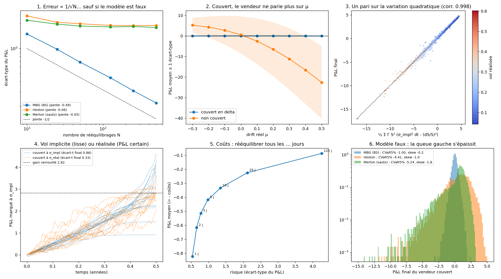

# OptionPricer

**Le métier de vendeur d'options, en Python : pricing, couverture dynamique et lecture de la volatilité.**

> **Question du projet :** un vendeur d'options qui couvre intelligemment et lit l'état de la volatilité fait-il mieux qu'un vendeur naïf ?

---

## Le fil rouge

> **Le prix d'une option est le coût de sa réplication. Un vendeur couvert ne parie donc pas sur la direction du marché, mais sur sa volatilité.**

Chaque phase du projet creuse une facette de cette phrase :

| Phase | Verbe | Question |
|---|---|---|
| **0. Socle** | construire | Les outils : pricer, simulateurs, moteur de couverture |
| **A. Anatomie du P&L** | comprendre | D'où viennent les gains et pertes d'un vendeur couvert ? |
| **C. Couverture optimale** | couvrir | Quelle est la meilleure façon de rééquilibrer ? |
| **B. Vendeur adaptatif** | décider | Quoi vendre, et quand, selon l'état de la volatilité ? |

L'ordre est volontaire : **A → C → B**. C reste dans le cadre de A (une option, plusieurs règles de couverture). B change d'échelle (un portefeuille dans le temps) et réutilise la meilleure couverture trouvée en C.

---

## Feuille de route

### Phase 0 : le socle

| Statut | Étape | Fichier | Contenu | Lien avec le cours |
|---|---|---|---|---|
| ✅ | **1. Prix** | `pricer/black_scholes.py` | Payoff, $d_1$, $d_2$, prix d'un call et d'un put | Prix = $\mathbb E^{\mathbb Q}[e^{-rT}h(S_T)]$ |
| ✅ | **2. Grecques** | `pricer/black_scholes.py` | Delta, gamma, vega, theta, volatilité implicite | Dérivées du prix, EDP de Black–Scholes |
| ✅ | **3. Vectorisation** | `pricer/black_scholes.py` | Pricer des milliers de cas d'un coup (numpy) | Indispensable pour la suite |
| ✅ | **4. Simulateurs** | `pricer/market.py` | MBG, Heston, MBG à régimes, Merton (sauts) | EDS, mouvement brownien géométrique |
| ✅ | **5. Couverture** | `pricer/hedging.py` | Portefeuille autofinancé : prime, delta, rééquilibrage, coûts | Intégrale d'Itô $\int \varphi\,dS$, processus adaptés |
| ✅ | **6. Attribution** | `pricer/attribution.py` | P&L décomposé en delta, gamma, theta, carry, coûts | Formule d'Itô discrète |

**Tests de validation du socle** (chacun vérifie une vérité indépendante du code) :
- [x] Valeurs de référence (Hull) : call $= 4{,}7594$, put $= 0{,}8086$
- [x] Parité call-put : $C - P = S - Ke^{-rT}$
- [x] Grecques ≈ différences finies
- [x] EDP de Black–Scholes : $\Theta + rS\Delta + \tfrac12\sigma^2S^2\Gamma - rV = 0$
- [x] Monte-Carlo sous $\mathbb Q$ ≈ formule fermée
- [x] Prix actualisé martingale sous $\mathbb Q$ : $\mathbb E[e^{-rt}S_t] = S_0$
- [x] Volatilité réalisée ≈ $\sqrt{[\log S]_T / T}$ (variation quadratique)

### Phase A : anatomie du P&L (comprendre)

Des expériences dont on **connaît le résultat théorique** : `pricer/experiments.py`, tests dans `tests/test_experiments.py`, figure produite par `python examples/phase_a.py` (ou `python main.py phasea`).

- [x] **Erreur de couverture en $1/\sqrt N$** : rééquilibrer 4 fois plus souvent divise le risque par 2
- [x] **Indépendance au drift $\mu$** : la réplication élimine les anticipations
- [x] **Vendre de la volatilité** : $\text{P\&L} \approx \tfrac12\int_0^T \Gamma_t S_t^2\,(\sigma_{\text{impl}}^2 - \sigma_{\text{réal}}^2)\,dt$, autrement dit un pari sur la **variation quadratique**
- [x] **Couvrir avec la vol implicite ou avec la vol réalisée** : P&L lisse mais aléatoire, contre P&L final certain mais chemin bruité
- [x] **Coûts de transaction** : précision de la couverture contre coût
- [x] **Modèle faux** (Heston, sauts) : où la couverture en delta casse



**Ce qu'on en retient** (call ATM 6 mois, vol 20 %, 10 000 trajectoires) :

| Expérience | Résultat |
|---|---|
| Erreur contre N | Pente log-log de −0,49 sous MBG. Sous Heston et avec sauts, la pente est d'environ −0,05 : l'erreur **plafonne** vers 1,8, et rééquilibrer plus souvent ne sert plus à rien. |
| Drift | Couvert, le P&L moyen reste à 0 ± 0,05 pour μ de −30 % à +50 %. Non couvert, il va de +5,2 à −22,6. |
| Pari sur la vol | Vendu à 25 % avec une vol réalisée de 15 % : P&L de +2,82. La formule ½ Σ Γ S² (σ_impl² dt − (dS/S)²) prédit chaque trajectoire avec une corrélation de 0,998. |
| Vol implicite ou réalisée | Même gain moyen (2,82, verrouillé). L'écart-type final vaut 0,86 en couvrant à σ_impl contre 0,33 en couvrant à σ_réal (ce reste n'est que la discrétisation), mais dans le second cas le livre est bruité en cours de route. |
| Coûts (20 pb) | Rééquilibrer chaque jour coûte 0,82 avec un écart-type de 0,53. Chaque semaine : 0,42 et 0,98. On obtient une frontière risque/coût, sans optimum évident, ce qui motive la phase C. |
| Modèle faux | La CVaR 5 % passe de −1,0 (MBG) à −4,4 (Heston) et −5,2 (sauts), avec un skew de −1,8 : la queue gauche du vendeur vient de ce que le delta ne couvre pas. |

### Phase C : couverture optimale (couvrir)

- [ ] **Règles classiques** sous coûts de transaction :
  - rééquilibrage à intervalles fixes ;
  - bandes de delta (Whalley–Wilmott) ;
  - volatilité ajustée des coûts (Leland).
- [ ] Comparaison des distributions de P&L : moyenne, écart-type, CVaR
- [ ] **Bonus, deep hedging** : un réseau de neurones apprend la stratégie qui minimise la CVaR. Bat-il le delta sous Heston avec coûts ?

### Phase B : vendeur adaptatif (décider)

- [ ] **Mesurer la volatilité** : close-to-close, Parkinson, Garman–Klass, Yang–Zhang
- [ ] **La prévoir** : EWMA, GARCH(1,1), HAR-RV
- [ ] **Prime de variance** : vol implicite moins vol réalisée prévue, *le* signal du vendeur
- [ ] **Détecter les régimes** (calme, tension, crise) : seuils sur le VIX, puis modèle de Markov caché
- [ ] **Adapter la stratégie au régime** :

  | Régime | Stratégie |
  |---|---|
  | Vol basse, prime de variance élevée | Vendre des straddles ou strangles couverts en delta |
  | Vol en hausse | Réduire l'exposition vega, rééquilibrer plus souvent |
  | Stress (VIX élevé, sauts) | Arrêter de vendre, acheter des puts hors de la monnaie en protection |
  | Retour au calme | Revendre de la volatilité, alors chère |

- [ ] **Backtest** : sur simulations d'abord (régimes connus), puis sur données réelles (S&P 500 et VIX, en incluant 2008, 2020 et 2024)
- [ ] **Comparaison** : vendeur adaptatif contre vendeur naïf (vend toujours, couvre chaque jour)

---

## Structure du projet

```
OptionPricer/
├── pricer/
│   ├── __init__.py
│   ├── black_scholes.py   prix, grecques, volatilité implicite
│   ├── market.py          simulateurs de trajectoires
│   ├── hedging.py         portefeuille autofinancé, stratégies de couverture
│   ├── attribution.py     décomposition du P&L
│   ├── experiments.py     phase A : expériences sur le P&L du vendeur couvert
│   └── vol.py             estimation, prévision, régimes (phase B)
├── tests/                 un fichier de test par module
├── notebooks/             expériences et graphiques
├── pyproject.toml
└── README.md
```

## Installation

```bash
python3 -m venv .venv
source .venv/bin/activate
pip install numpy scipy matplotlib pytest
pytest -v
```

## Conventions

- `T` dans les fonctions Black–Scholes = temps **restant** jusqu'à la maturité, en années.
- `r` = taux sans risque continu ; `sigma` = volatilité annuelle (0.2 = 20 %).
- `position = -1` : on a **vendu** l'option.
- Une stratégie de couverture ne lit que le **passé** des prix : elle est *adaptée* à la filtration. C'est la règle d'or contre le biais d'anticipation.

## Pièges à surveiller

- **Biais d'anticipation** : un signal à la date $t$ n'utilise que les données jusqu'à $t$.
- **Surapprentissage** : calibrer les seuils de régime sur une période, tester sur une autre.
- **Queues de distribution** : vendre des options, c'est gagner souvent un peu et perdre rarement beaucoup. On regarde la **CVaR**, pas seulement la moyenne.
- **Données d'options** : l'historique est payant. Hypothèse assumée : options repricées en Black–Scholes avec le VIX comme volatilité implicite.

## Lien avec le cours

| Notion du cours | Rôle dans le projet |
|---|---|
| Martingales, filtrations | Prix actualisé martingale sous $\mathbb Q$ ; stratégies adaptées |
| Martingale fermée | Prix de l'option = martingale fermée par le payoff |
| Théorème d'arrêt | Options barrières et américaines ; pas d'arbitrage par le timing |
| Intégrale d'Itô | Gain du portefeuille $\int \varphi\,dS$ |
| Formule d'Itô | Dynamique de $V(t,S_t)$, EDP, delta, attribution du P&L |
| Martingale exponentielle | Prix actualisé sous $\mathbb Q$, densité de Girsanov |
| EDS | Modèles de prix (MBG, Heston) |
| Variation quadratique | Volatilité réalisée ; le pari du vendeur d'options |

---

## Extension : données réelles et Monte-Carlo (matières premières)

| Module | Contenu |
|---|---|
| `pricer/data.py` | Futures réels via Yahoo Finance (café `KC=F`, cacao `CC=F`, sucre `SB=F`...), cache local dans `data/`, vol réalisée, saisonnalité, queues épaisses, détection des sauts |
| `pricer/black76.py` | Modèle de Black-76 : options sur futures (le future est une martingale sous $\mathbb Q$) |
| `pricer/montecarlo.py` | Prix Monte-Carlo avec intervalle de confiance, variable de contrôle, options asiatiques, barrières, lookback, grecques par différences finies |
| `pricer/closed_forms.py` | Formules de référence : asiatique géométrique (Kemna–Vorst), Merton (série) |
| `pricer/calibration.py` | Estimation des modèles MBG, Merton (sauts) et Schwartz (retour à la moyenne) |

```bash
pip install -r requirements.txt
python examples/coffee_analysis.py            # café (nécessite internet au 1er lancement)
python examples/coffee_analysis.py --ticker CC=F   # cacao
```

**Limite assumée :** les historiques de prix d'options sur matières premières ne sont pas disponibles gratuitement. On price donc avec la volatilité *réalisée* et des modèles calibrés sur l'historique du future, pas avec une volatilité implicite de marché.
